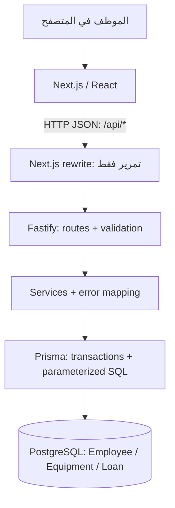

# 01 — معمارية النظام وحدوده

## الحالة والمصادر وبوابة الدخول
التصميم مقترح للمراجعة، ولم يُطبق. أكد المالك في المحادثة «اعتمد الصريح phase 00» ثم «اعتمد الصريح phase 01»، ثم طلب تنفيذ Phase 02. هذه أدلة الاعتماد الحالية. حالة BLOCKED في تقرير Phase 01 تاريخية؛ لم نغير التقرير ولا ننسب إليه اعتمادًا لم يكن موجودًا وقت كتابته. لا يعني الاعتماد وجود تطبيق أو نجاح اختبار.

قُرئ تقرير Phase 01 كاملًا مع تدقيق المشروع والبيئة والواجهة والخلفية والقاعدة والقواعد وAPI والاختبارات والمخاطر والخطة. مصدر المتطلبات Phase 00 والتكليف الحالي؛ هذه الحزمة تحولها إلى تصميم فقط.

| تعارض أو تطور | المصدر | المعالجة المعلنة |
|---|---|---|
| BLOCKED مقابل الاعتماد الحالي | تقرير Phase 01 ثم رسالتا المالك | توثيق الاعتماد اللاحق هنا دون إعادة كتابة التاريخ |
| ترقيم قواعد العمل | Phase 00/04 مقابل قائمة Phase 01 | اعتماد P00-BR كمرجع هذه الحزمة؛ مصفوفة المطابقة في Phase 01/06؛ P01-BR-02 يوضح السماح بأنواع مختلفة |
| حسم التصميم في Phase 01 | بعض نصوص Phase 00 | التكليف الحالي يخصص الحسم لـPhase 02؛ لا تغيير صامت للمصدر |
| /equipment مقابل /api/equipment | مسارات Phase 00 المقترحة مقابل التكليف الحالي | بادئة /api بالعقد الجديد، لا توجد endpoints قديمة لكسر توافقها |
| توثيق ثنائي اللغة سابقًا مقابل العربية حاليًا | طلبا المالك | مستندات Phase 02 عربية؛ الملفات السابقة لا تتغير |
| اختيار إصدارات مقابل منع تغييرها | فجوة Audit وقيد Phase 02 | لا تغيير أو تثبيت؛ exact versions قرار مفتوح قبل التنفيذ |

## المنتج والمستخدمون
المشكلة تنظيم استعارة وحدات معدات مشتركة وإرجاعها مع إبقاء الرصيد والتاريخ متسقين. الموظف هو الدور الوحيد؛ الموظفون seeded، والاختيار ليس مصادقة. شاشة واحدة تعرض الموظفين والأنواع والإجمالي والمتاح والاستعارة النشطة وتتيح Borrow/Return وإعادة الاستعارة. التاريخ يُحفظ دون شاشة إدارة أو سجل تاريخ معروض مطلوب.

## المعمارية

| الجزء | المسؤولية والحد |
|---|---|
| Next.js App Router وReact | العرض وحالة الموظف والطلبات والرسائل؛ لا Prisma أو DATABASE_URL |
| Next.js rewrite | proxy نقل نحو Fastify؛ لا قواعد عمل أو database access أو Backend بديل |
| Fastify routes | التحقق البنيوي وربط HTTP بخدمات واضحة؛ handler صغير يؤدي دور controller دون مجلد فارغ إلزامي |
| Services | أهلية الاستعارة والإرجاع وحدود transaction وترجمة نتائج الأعمال |
| Prisma | وصول خلفي فقط، كل استعلام في العملية يستخدم tx نفسه؛ raw SQL محدود للقفل وبقيم مربوطة |
| PostgreSQL | التخزين والعلاقات وCHECK وpartial unique index والأقفال |

لا أنظمة خارجية سوى PostgreSQL المطلوب؛ لا auth provider أو queue أو distributed service. الواجهة تستخدم روابط نسبية حتى يعمل الوصول عبر أي host أو preview دون localhost في المتصفح. backend المحلي يمكن أن يستخدم loopback كوجهة server-side فقط.

## قيود النطاق
لا Authentication أو User Registration أو RBAC أو Admin/Equipment Management Dashboard أو إدارة موظفين/مخزون أو Reservations أو Due Dates أو Fines أو Notifications أو Background Jobs أو Message Queues أو Microservices أو Distributed Architecture أو Serial Tracking أو Production Deployment Pipeline. كذلك لا CI أو stress infrastructure أو elaborate styling أو custom monorepo tooling أو shared components library غير لازمة. لا أهداف أداء أو إنتاج مخترعة.
