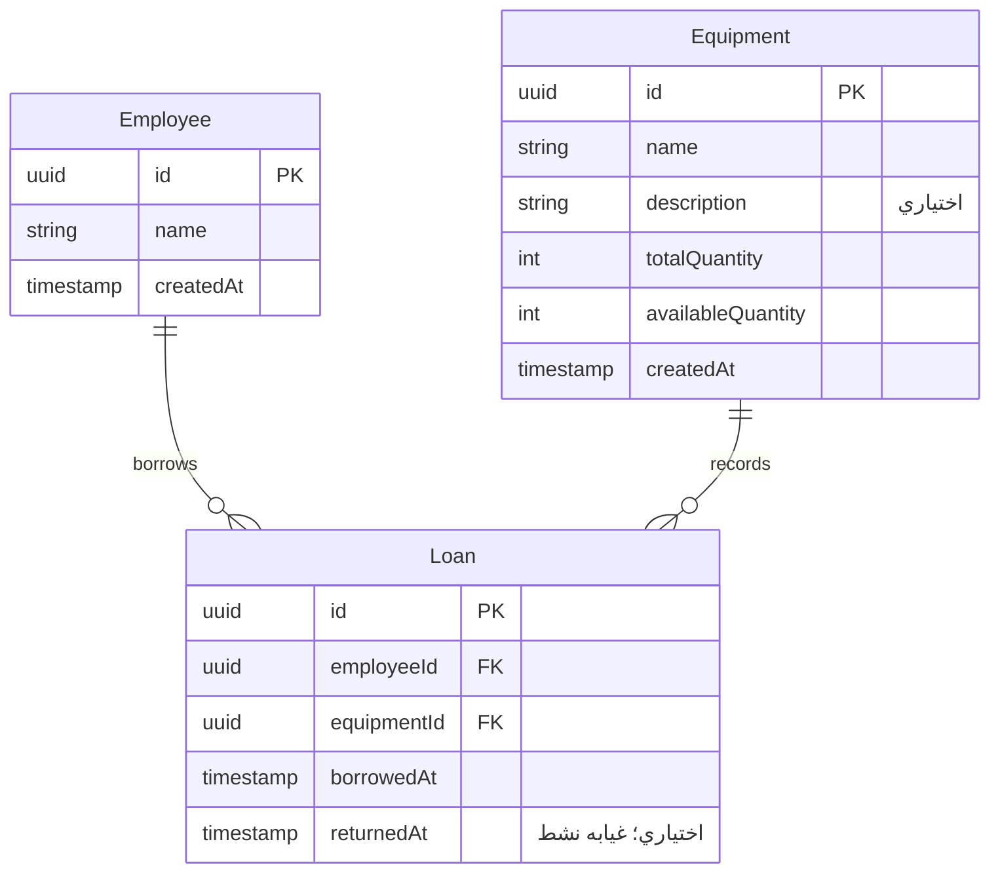

# 03 — تصميم قاعدة البيانات والعلاقات

## قرارات النموذج
PostgreSQL مع Prisma؛ ثلاثة كيانات فقط. UUID يولده التطبيق عند إنشاء السجل ويُخزن بنوع uuid؛ لا حاجة extension لتوليده بقاعدة البيانات. الأوقات timestamptz(3)؛ API يعيد UTC ISO 8601. status مشتق من returnedAt ولا يُخزن لتجنب مصدرَي حقيقة. لا quantity في Loan؛ كل سجل وحدة. لا createdAt/updatedAt إضافيان في Loan لأن borrowedAt/returnedAt يصفان دورة حياته الوحيدة، ولا editing endpoint. Employee وEquipment يحتفظان createdAt فقط؛ تحديثات إدارية وتدقيق عام ليست مطلوبة. description اختيارية.

| الكيان | الحقول والنوع | nullable / المعنى |
|---|---|---|
| Employee | id UUID PK؛ name text؛ createdAt timestamptz(3) | كلها NOT NULL؛ الاسم غير فريد ولا يُستخدم كهوية |
| Equipment | id UUID PK؛ name text؛ description text؛ totalQuantity integer؛ availableQuantity integer؛ createdAt timestamptz(3) | description وحدها nullable؛ باقي الحقول NOT NULL؛ الإجمالي ثابت بعد seed ضمن النطاق |
| Loan | id UUID PK؛ employeeId UUID FK؛ equipmentId UUID FK؛ borrowedAt timestamptz(3)؛ returnedAt timestamptz(3) | returnedAt وحده nullable؛ NULL نشط وغير NULL مكتمل |

## العلاقات ودورة الحياة
Employee واحد إلى صفر أو أكثر من Loan؛ Equipment واحد إلى صفر أو أكثر من Loan. كل Loan له موظف ونوع موجودان بالضبط. onDelete وonUpdate يختاران Restrict للمراجع؛ الهوية لا تتغير ضمن API. لا حذف تاريخي ولا cascade. النوع ليس وحدة فردية. يجوز لموظف استعارة أنواع مختلفة في الوقت نفسه.

الإرجاع يعدل returnedAt للسجل نفسه ولا يحذفه. استعارة لاحقة تنشئ UUID جديدًا وتحتفظ بهويات وتواريخ كل الدورات السابقة. اكتمال Loan هو سجل الإرجاع؛ لا Return entity منفصل ولا endpoint لاستعراض history مطلوب.

## التمثيل في Prisma
الحقول والعلاقات السابقة تُحوّل لاحقًا إلى models Employee وEquipment وLoan، مع @id و@db.Uuid و@db.Timestamptz(3) وoptional returnedAt/description، وحقول علاقات loans/employee/equipment. يُفصل تكوين datasource/client عن النموذج بحسب إصدار Prisma المعتمد. لا schema.prisma فعلية هنا، ولا @unique عام للزوج، ولا status enum أو حقل quantity.

الإجمالي والمتاح محفوظان لتبسيط العرض والتحديث؛ التكلفة ضرورة حماية invariant عبر المعاملات ومراجعة stock reconciliation. constraints التفصيلية ومسار migrations في الوثيقة 04. دقة clock الفعلية ليست معيار ترتيب للمعاملات؛ القفل يحكم ترتيب التعديل.
