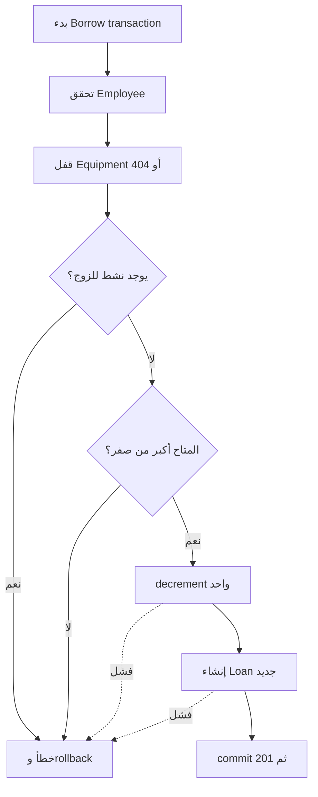
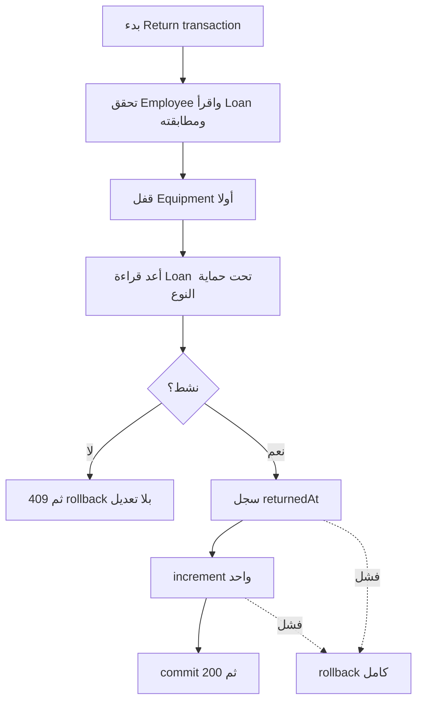

# 05 — تصميم المعاملات والتزامن

## الاختيار ولماذا
الآلية الأساسية **Prisma interactive transaction بعزل ReadCommitted + قفل صف Equipment بواسطة SELECT FOR UPDATE داخل tx**. كل Borrow وReturn للنوع نفسه يكتسب القفل نفسه قبل قراءة أهلية متغيرة أو الكتابة. الفرادة الجزئية وCHECK دفاعات DB للثوابت وليست بديلًا للقفل. كل استعلام ضمن العملية يستخدم tx نفسه على الاتصال نفسه. لا network calls داخل المعاملة، وتبقى قصيرة. لا process mutex أو distributed lock.

| الاستراتيجية | التقييم والقرار |
|---|---|
| Conditional Atomic Update | صالح لتنافس المخزون مع transaction، لكنه وحده لا يحمي حالة الاستعارة؛ لا نجعله آلية تزامن ثانية فوق قفل موحد |
| Database Transactions | ضرورية لأن العملية تغير صف المخزون وLoan معًا |
| Row-Level Locking | مختارة؛ ترتيب واحد سهل الشرح للنوع، يغطي Borrow وReturn معًا |
| Unique constraints | partial unique مختار كقيد سلامة مباشر للقاعدة، لا قفل مستخدم شامل |
| Isolation | ReadCommitted للكتابة بعد القفل وإعادة الفحص؛ Serializable ليس لازمًا مع هذا البروتوكول؛ RepeatableRead يستخدم فقط لقراءة القائمة المتسقة |

مرجع واجهة المعاملات الموصوفة هو [Prisma v7 interactive transactions](https://www.prisma.io/docs/orm/v7/prisma-client/queries/transactions). اختيار عائلة API v7 هنا مرجع تصميم؛ رقم patch والتوافق والتهيئة الفعلية مفتوحة. الوثائق الأحدث ليست مطابقة بالضرورة؛ إذا اعتُمد إصدار بواجهة مختلفة يجب تحديث التفاصيل قبل التنفيذ، لا نسخ syntax قديم بصمت.

## Borrow خطوة بخطوة
1. route يتحقق من UUID وبنية body ويرسل الموظف والنوع إلى الخدمة.
2. تبدأ interactive transaction بعزل ReadCommitted. تتحقق من وجود Employee؛ الغائب 404.
3. تقرأ Equipment بقفل FOR UPDATE؛ إن لم يوجد 404. هذا أول قفل كتابة مقصود.
4. **بعد القفل** تقرأ Loan النشط للزوج. إن وجد 409 ALREADY_BORROWED، قبل فحص نفاد المخزون لتثبيت أولوية الخطأ.
5. تقرأ المتاح من الصف المقفول؛ صفر ينتج 409 OUT_OF_STOCK دون كتابة.
6. تخفض المتاح واحدًا باستخدام decrement، ثم تنشئ Loan جديدًا بهوية جديدة وborrowedAt وreturnedAt = NULL.
7. لا نجاح إلا بعد commit. أي خطأ يُرمى خارج callback كي تتراجع كل الكتابات. لا catch داخل المعاملة يحول الخطأ إلى نجاح.

## Return خطوة بخطوة وترتيب الأقفال
1. تحقق بنيوي من loanId وemployeeId، ثم ابدأ transaction بعزل ReadCommitted وتحقق من Employee.
2. اقرأ Loan لتحديد equipmentId وتحقق من وجوده ومطابقة الموظف؛ الغياب وعدم التطابق كلاهما 404 LOAN_NOT_FOUND. هذه قراءة أولية **دون قفل Loan**، ولا تكفي لتقرير نشاطه.
3. اقفل Equipment الخاص بالسجل أولًا. لا مسار يأخذ قفل Loan ثم ينتظر Equipment. روابط السجل immutable ولا deletion endpoints.
4. أعد قراءة Loan بالهوية والموظف بعد اكتساب القفل، وتحقق من النشاط الحالي. returnedAt غير NULL ينتج 409 ALREADY_RETURNED بلا تغيير.
5. عدل returnedAt مرة واحدة. وقت الإكمال يؤخذ بعد التحقق، ولا يعاد تعيينه في طلب مكرر. زد Equipment.availableQuantity واحدًا.
6. commit ثم 200 مع السجل المكتمل. فشل أي كتابة أو check يعيد السجل والمخزون معًا. غياب Equipment لسجل موجود خلل integrity ينتج 500 لا زيادة وهمية.

## دليل منطقي لنتائج التداخل — ليس اختبارًا منفذًا
| التداخل | التسلسل الذي يفرضه التصميم | النتيجة |
|---|---|---|
| موظفان وآخر وحدة | الأول يقفل ويستهلك ويثبت؛ الثاني ينتظر ثم يقرأ الرصيد المحدث | واحد 201 والآخر 409 OUT_OF_STOCK في الظروف الطبيعية |
| الزوج نفسه ومخزون كافٍ | الثاني بعد انتظار القفل يعيد قراءة النشط | سجل جديد واحد؛ الثاني 409 ALREADY_BORROWED |
| Return للسجل نفسه مرتين | الثاني يقرأ returnedAt بعد تحرير قفل النوع | زيادة واحدة و409 للآخر |
| Borrow/Return للزوج نفسه | القرار حسب من اكتسب قفل النوع أولًا | إن Borrow أولًا يرفض لوجود النشط؛ إن Return أولًا قد تنجح استعارة جديدة بسجل مختلف |
| موظف واحد ونوعان | أقفال Equipment مختلفة | لا منع شامل على الموظف؛ كلاهما جائز |

لا lost update لأن increment/decrement داخل القفل، ولا stock سالب بسبب الفحص المحمي وCHECK. حدود التصميم: عمليات النوع الواحد متسلسلة؛ هذا مقبول لحجم المهمة دون اختراع throughput target. كل مسار كتابة وseed مستقبلًا يجب أن يحترم البروتوكول؛ SQL خارجي قد يكسر مصالحة التاريخ/الرصيد رغم CHECK.

## التعامل مع التعارض والفشل
- partial unique المعروف: rollback كامل ثم 409 ALREADY_BORROWED؛ لا إبقاء الخصم إذا فشل insert.
- deadlock/serialization conflict مثبت أنه أُجهض: rollback ثم 409 TRANSACTION_CONFLICT دون retry تلقائي؛ الواجهة تعيد الجلب قبل عرض إعادة المحاولة اليدوية.
- فشل اتصال أو نتيجة commit غامضة: 500 عام إن أمكن الرد، مع عدم ادعاء أن commit لم يقع. لا retry mutation تلقائيًا؛ refetch أولًا. الذرية تمنع الجزئية لكنها لا تجعل الشبكة exactly-once.
- CHECK/FK غير متوقع بعد التحقق: 500 ومعالجة داخلية آمنة، لا تحويل كل integrity error إلى 409.
- لا Prisma raw unsafe أو interpolation نصي؛ قفل الصف عبر parameterized query على tx فقط. لا lock خارج transaction.

قراءة قائمة المعدات تستخدم read-only interactive transaction بعزل RepeatableRead: تحقق employee ثم اجلب المعدات وactive loans داخل snapshot نفسها حتى لو نفذ Prisma عدة SELECTs. لا قفل كتابة للقراءات ولا ضمان بقاء التوفر بعد الرد.
