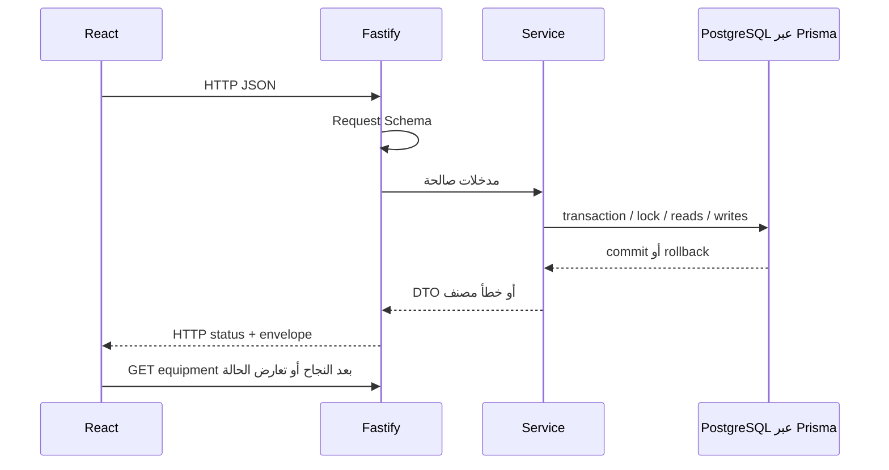

# 06 — عقد REST API المقترح للاعتماد

العقد تصميم وليس endpoints منفذة. جميع المسارات تحت /api، والاتصال HTTP/JSON. لا auth. Content-Type للطلبات ذات body هو application/json. معرفات UUID (صيغة قياسية 8-4-4-4-12 وصالحة لمحلل UUID)، والأوقات UTC ISO 8601. الحقول المطلوبة لا تقبل null. unknown body/query fields وquantity تُرفض 400 ولا تُحذف بصمت؛ query مكرر أو UUID غير صالح مرفوض. لا pagination أو filtering غير مطلوبين؛ ترتيب القوائم name ثم id لثبات العرض.

## Envelope وتعريف DTO
| النوع | العقد |
|---|---|
| نجاح | success=true وdata؛ لا message إلزامية والواجهة تختار رسالة عربية حسب الإجراء |
| فشل | success=false وerror يحوي code ثابتًا وmessage عربية آمنة؛ fields اختياري لخريطة أخطاء حقول التحقق |
| EmployeeDTO | id وname فقط |
| EquipmentDTO | id وname وdescription (string أو null) وtotalQuantity وavailableQuantity وactiveLoan (null أو {id,borrowedAt}) |
| LoanDTO | id وemployeeId وequipmentId وborrowedAt وreturnedAt (null أو timestamp)؛ لا status مخزن أو quantity |

تعليق JSON غير مسموح؛ لذلك الأمثلة JSON صالحة دون comments، وتفسير كل حقل في الجداول والنص. جميع الهويات والأوقات في الأمثلة توضيحية وليست بيانات موجودة.

## GET /api/employees
لا مدخلات؛ 200 وdata={employees: EmployeeDTO[]}. [] نجاح فارغ لا خطأ. endpoint قراءة منفصل ضروري للمحدد قبل اختيار employeeId؛ لا إنشاء أو تعديل أو حذف موظف.
```json
{"success":true,"data":{"employees":[{"id":"11111111-1111-4111-8111-111111111111","name":"أحمد"}]}}
```

## GET /api/equipment?employeeId={employeeId}
employeeId إلزامي موجود؛ 400 عند سوء الصيغة/الغياب، 404 EMPLOYEE_NOT_FOUND للغائب. 200 وdata={employeeId,equipment: EquipmentDTO[]}. التحقق والقراءة المتسقة وفق الوثيقة 05. activeLoan يخص الموظف المحدد فقط، وليس موظفًا آخر. لا حقل boolean يناقض activeLoan. إجمالي ومتَاح كل نوع أعداد صحيحة، و[] قائمة فارغة صحيحة.
```json
{"success":true,"data":{"employeeId":"11111111-1111-4111-8111-111111111111","equipment":[{"id":"22222222-2222-4222-8222-222222222222","name":"شاشة","description":null,"totalQuantity":2,"availableQuantity":1,"activeLoan":{"id":"33333333-3333-4333-8333-333333333333","borrowedAt":"2026-11-18T08:00:00.000Z"}}]}}
```

## POST /api/loans
body بالضبط employeeId وequipmentId. لا quantity. التحقق: schema ثم الموظف ثم المعدات تحت القفل ثم النشط ثم المتاح. عند عدم وجود كليهما الأولوية EMPLOYEE_NOT_FOUND. 201 وdata={loan: LoanDTO} بعد commit فقط؛ returnedAt=null. لا يحتاج الرد مخزونًا؛ الواجهة تعيد جلبه.
```json
{"employeeId":"11111111-1111-4111-8111-111111111111","equipmentId":"22222222-2222-4222-8222-222222222222"}
```
```json
{"success":true,"data":{"loan":{"id":"33333333-3333-4333-8333-333333333333","employeeId":"11111111-1111-4111-8111-111111111111","equipmentId":"22222222-2222-4222-8222-222222222222","borrowedAt":"2026-11-18T08:00:00.000Z","returnedAt":null}}}
```

## POST /api/loans/{loanId}/return
loanId UUID صالح وbody بالضبط employeeId. تحقق الموظف ثم وجود السجل ومطابقته ثم النشاط تحت القفل. 200 وdata={loan: LoanDTO} مع returnedAt غير null. الإرجاع المتكرر 409 لا نجاح وهمي، والرصيد لا يتغير.
```json
{"employeeId":"11111111-1111-4111-8111-111111111111"}
```
```json
{"success":true,"data":{"loan":{"id":"33333333-3333-4333-8333-333333333333","employeeId":"11111111-1111-4111-8111-111111111111","equipmentId":"22222222-2222-4222-8222-222222222222","borrowedAt":"2026-11-18T08:00:00.000Z","returnedAt":"2026-11-18T09:00:00.000Z"}}}
```

## حالات HTTP والأخطاء
| HTTP | code | متى |
|---|---|---|
| 200 | لا error | قائمة موظفين/معدات أو إرجاع ناجح |
| 201 | لا error | استعارة مثبتة جديدة |
| 400 | VALIDATION_ERROR | JSON مشوه، معرف ناقص/غير صالح، null، حقل إضافي أو كمية |
| 404 | EMPLOYEE_NOT_FOUND | موظف غير موجود |
| 404 | EQUIPMENT_NOT_FOUND | نوع مطلوب غير موجود |
| 404 | LOAN_NOT_FOUND | سجل غير موجود أو لا يخص الموظف المحدد |
| 404 | ROUTE_NOT_FOUND | مسار غير معرف؛ نفس envelope |
| 409 | ALREADY_BORROWED | نشط مطابق أو unique index معروف |
| 409 | OUT_OF_STOCK | المخزون صفر |
| 409 | ALREADY_RETURNED | returnedAt موجود |
| 409 | TRANSACTION_CONFLICT | تعارض معاملة مثبت الإجهاض؛ لا retry تلقائي |
| 500 | INTERNAL_SERVER_ERROR | فشل داخلي/تخزين غير متوقع؛ دون stack أو SQL أو أسرار |

```json
{"success":false,"error":{"code":"OUT_OF_STOCK","message":"لا توجد وحدات متاحة من هذا النوع."}}
```

يمكن أن تعيد طبقة HTTP رمزًا قياسيًا مثل 415 لنوع محتوى غير مدعوم؛ يُطبع envelope نفسه عند المعالجة داخل Fastify، ولا يُحوّل عدم التوفر البروتوكولي إلى خطأ عمل. أخطاء proxy/الشبكة قد لا تكون JSON؛ api-client يعاملها كفشل نقل عام لا يحاول عرض HTML أو تفاصيل داخلية.


